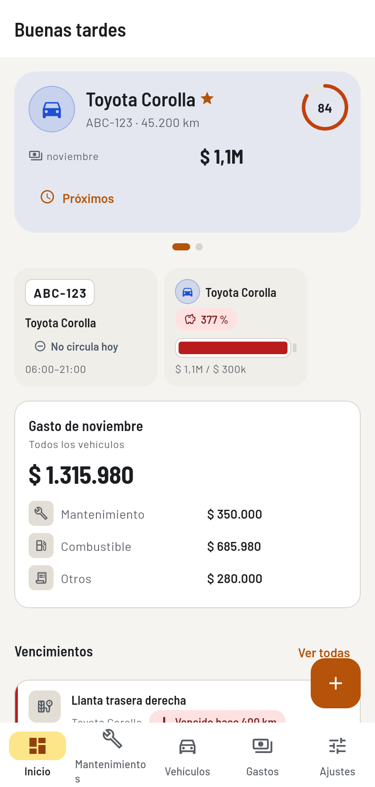
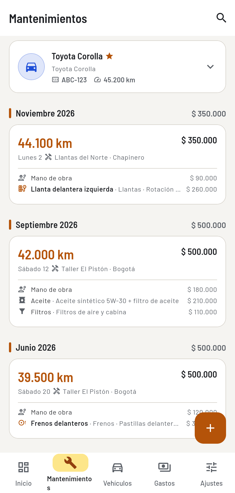
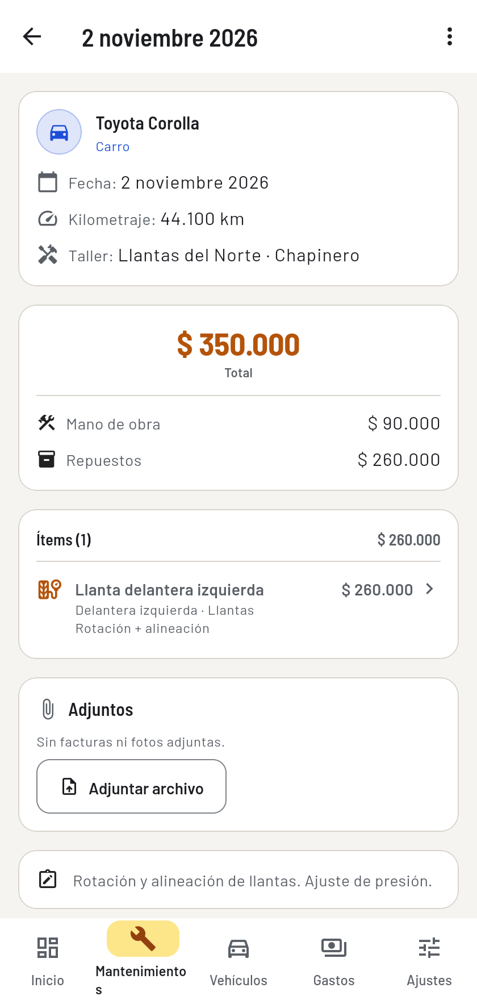
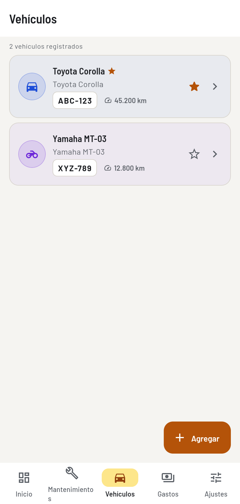
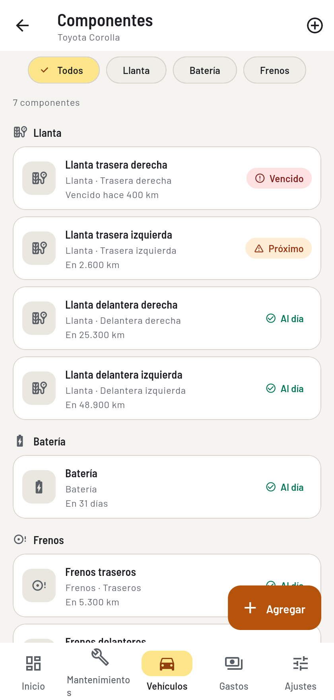
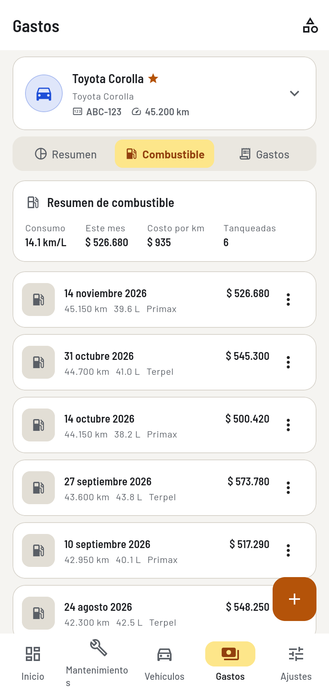
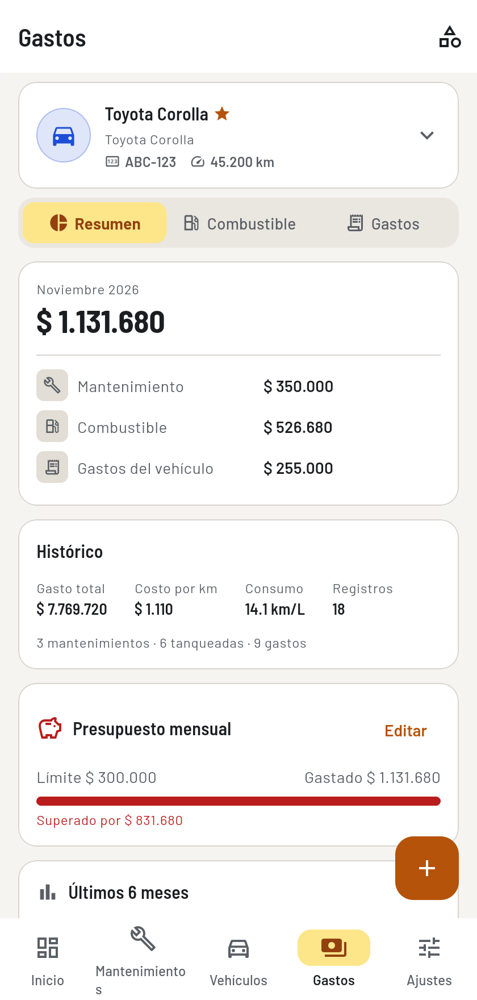
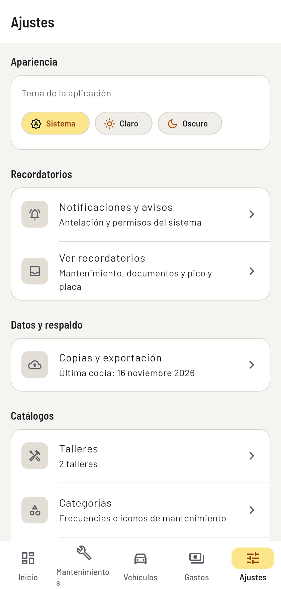

# MotorCheck

[](https://flutter.dev)
[](https://dart.dev)
[](https://developer.android.com)
[](https://ubuntu.com)
[](LICENSE)

Aplicación Flutter para el seguimiento del mantenimiento personal de
vehículos: mantenimientos, componentes, combustible, gastos, documentos y
recordatorios. **100 % local con SQLite, sin cuenta y sin conexión a internet.**

## Contenido

- [Características](#-características)
- [Capturas de pantalla](#-capturas-de-pantalla)
- [Inicio rápido](#-inicio-rápido)
- [Cómo funciona](#-cómo-funciona)
- [Tecnologías](#-tecnologías)
- [Arquitectura](#-arquitectura)
- [Comandos de desarrollo](#-comandos-de-desarrollo)
- [Linux / Ubuntu](#-linux--ubuntu)
- [Privacidad y datos](#-privacidad-y-datos)
- [Licencia](#-licencia)

## ✨ Características

**Vehículos y mantenimiento**
- Vehículos múltiples: carros, motos, bicicletas, patinetas eléctricas y camiones
- Mantenimientos con varios items (aceite, llantas, filtros, frenos…), con
  costo de mano de obra y repuestos por item
- Próximos servicios por kilometraje **o por tiempo** (lo que ocurra primero)
- Historial de kilometraje con gráfica y lecturas manuales
- Adjuntos de facturas y fotos con previsualización (imagen y PDF)

**Componentes con desgaste**
- Llantas individuales, batería, cadena, frenos y suspensión, cada uno con su
  propia vida útil
- Reemplazo registrado dentro del mantenimiento, con historial por pieza
- Plantillas de componentes por tipo de vehículo

**Combustible y finanzas**
- Bitácora de tanqueadas con consumo real (km/L) y costo por km
- Gastos por vehículo o globales: seguro, impuesto, peajes, multas y más
- Resumen mensual, presupuesto con alertas, gasto de la flota y gráfica de
  los últimos 6 meses

**Documentos y avisos**
- SOAT, tecnomecánica (RTM), impuesto, seguro y licencia con adjuntos PDF o imagen
- Recordatorios de mantenimiento y de vencimiento de documentos
- Pico y placa semanal en el mosaico de inicio (solo restricciones activas)

**Herramientas y plataforma**
- Registro rápido desde el FAB: mantenimiento, kilometraje, tanqueada y gasto
- Checklists e inspecciones pre-viaje
- Hoja de vida del vehículo en PDF
- Copia de seguridad ZIP (datos + adjuntos) y exportación CSV
- Tema claro/oscuro con sistema de diseño consistente
- Interfaz en español con formatos es_CO (moneda, fechas y kilometraje)
- Disponible en **Android** y **Linux (escritorio Ubuntu)**

## 📸 Capturas de pantalla

Con datos de ejemplo: vehículos ficticios con mantenimientos, tanqueadas,
gastos, documentos y componentes con desgaste real.

<table>
  <tr>
    <td align="center">
      
      <br><em>Inicio</em>
    </td>
    <td align="center">
      
      <br><em>Mantenimientos</em>
    </td>
    <td align="center">
      
      <br><em>Detalle de mantenimiento</em>
    </td>
    <td align="center">
      
      <br><em>Vehículos</em>
    </td>
  </tr>
  <tr>
    <td align="center">
      
      <br><em>Componentes con desgaste</em>
    </td>
    <td align="center">
      
      <br><em>Combustible</em>
    </td>
    <td align="center">
      
      <br><em>Resumen financiero</em>
    </td>
    <td align="center">
      
      <br><em>Ajustes</em>
    </td>
  </tr>
</table>

## 🚀 Inicio rápido

```bash
git clone https://github.com/afperdomo2/motorcheck.git
cd motorcheck
flutter pub get
dart run build_runner build --delete-conflicting-outputs   # solo tras cambiar modelos
flutter run              # dispositivo seleccionado (Android)
flutter run -d linux     # escritorio Ubuntu (hot reload: r / R)
```

En VS Code: **Select Device** → teléfono Android o **Linux (desktop)** y F5.

> **Nota de entorno**: el SDK Flutter de este equipo está en
> `/home/felipe/Documentos/flutter` y no está en el `PATH`. Si `flutter` o
> `dart` no se encuentran, usa la ruta absoluta
> (`/home/felipe/Documentos/flutter/bin/flutter`).

## 🧭 Cómo funciona

Todo vive en una base SQLite local; no hay servidor ni sincronización.

| Concepto | Qué representa |
|----------|----------------|
| **Vehículo** | El vehículo con su kilometraje actual; uno puede ser el principal y otro el último seleccionado |
| **Mantenimiento** | Una intervención con fecha, kilometraje, taller, mano de obra y items (cada item con su repuesto) |
| **Componente** | Una pieza con vida útil propia (llanta, batería, cadena, frenos, suspensión) cuyo desgaste se calcula por km y por tiempo |
| **Tanqueada** | Una carga de combustible: odómetro, litros y precio → consumo real y costo por km |
| **Gasto** | Un gasto asociado al vehículo o global (seguro, impuesto, peajes, multas…) con categoría y recibo |
| **Documentos** | SOAT, RTM, impuesto, seguro y licencia, con fecha de vencimiento y archivo adjunto |
| **Recordatorio** | Una alerta derivada de lo anterior: próximo servicio, documento por vencer o pico y placa |

El kilometraje del vehículo **solo sube automáticamente**; corregirlo a la
baja es una acción manual desde *Editar vehículo*.

## 🔧 Tecnologías

| Capa | Tecnología |
|------|-----------|
| UI | Flutter 3.47 · Dart 3.13 |
| Estado | Riverpod 2.6 |
| Navegación | GoRouter 14.8 |
| Base de datos | SQLite — `sqflite` (Android) · `sqflite_common_ffi` (escritorio) |
| Código generado | freezed 3 + json_serializable |
| Pruebas | flutter_test + mocktail |

## 📁 Arquitectura

Estructura orientada a features con patrón Smart/Dumb components.

```
lib/
├── main.dart              # Punto de entrada + ProviderScope
├── app.dart               # MaterialApp.router + tema
├── core/                  # Infraestructura compartida
│   ├── theme/             # Sistema de diseño
│   ├── database/          # SQLite v22
│   ├── backup/            # Copias ZIP y CSV
│   ├── files/             # Almacenamiento de adjuntos
│   ├── notifications/     # Avisos locales
│   ├── settings/          # Preferencias
│   └── utils/             # Utilidades
├── features/              # Features de negocio
│   ├── vehicles/          # CRUD de vehículos y kilometraje
│   ├── maintenance/       # Mantenimientos y adjuntos
│   ├── documents/         # SOAT, RTM, impuesto, seguro y licencia
│   ├── fuel/              # Combustible y consumo
│   ├── expenses/          # Gastos y categorías
│   ├── finance/           # Resumen, presupuesto y costo por km
│   ├── checklists/        # Inspecciones pre-viaje
│   ├── components/        # Llantas, batería, cadena, frenos y suspensión
│   ├── restrictions/      # Pico y placa
│   ├── reminders/         # Bandeja de recordatorios
│   ├── reports/           # Hoja de vida PDF
│   ├── dashboard/         # Panel principal
│   └── settings/          # Configuración
├── shared/widgets/        # Componentes reutilizables
└── routes/                # Configuración de rutas (5 tabs)

test_driver/               # Entry para capturas del README (datos demo)
```

Documentación detallada en [`docs/`](docs/): [`architecture.md`](docs/architecture.md),
[`database.md`](docs/database.md), [`code-style.md`](docs/code-style.md),
[`DESIGN_SYSTEM.md`](docs/DESIGN_SYSTEM.md) y [`testing.md`](docs/testing.md).
Los planes históricos de implementación viven en [`docs/plans/`](docs/plans/).

## 🧩 Comandos de desarrollo

```bash
# Código generado (obligatorio después de modificar modelos @freezed)
dart run build_runner build --delete-conflicting-outputs
dart run build_runner watch --delete-conflicting-outputs   # en modo watch

# Calidad (mismo conjunto que ejecuta el pre-commit)
dart format .
flutter analyze
flutter test

# Pruebas
flutter test                                   # suite completa
flutter test test/features/vehicles/           # por feature
flutter test --name "formatea"                 # por nombre (regex)
```

### Hooks pre-commit (Lefthook)

```bash
go install github.com/evrone/lefthook@latest   # requiere Go instalado
lefthook install
```

Antes de cada commit se ejecutan automáticamente `dart format`,
`flutter analyze` y `flutter test`.

### Capturas del README

Las capturas se generan con datos de ejemplo en una base temporal (la base
real nunca se toca):

```bash
flutter run -t test_driver/app.dart -d linux
```

## 🐧 Linux / Ubuntu

La plataforma Linux ya está habilitada (carpeta `linux/` en la raíz). El mismo
código corre en Android y en escritorio; solo cambia el backend de SQLite.

### Requisitos

```bash
sudo apt install clang cmake ninja-build pkg-config libgtk-3-dev liblzma-dev
flutter doctor -v   # "Linux toolchain" debe quedar en verde
```

No hace falta instalar SQLite por separado: `sqflite_common_ffi` usa la
biblioteca del sistema (o el asset nativo que genera Flutter).

### Ejecutar y probar

```bash
flutter devices          # debe listar: Linux (desktop) • linux • linux-x64
flutter run -d linux     # hot reload (r) / hot restart (R)
```

La app abre en una ventana **420×880 centrada** (mínimo **360×600**),
pensada para el layout mobile-first.

### Base de datos

```
~/.local/share/com.example.motorcheck/motorcheck.db
```

- `sqflite` (el plugin móvil) no soporta escritorio: `initDatabaseFactory()`
  activa `sqflite_common_ffi` solo en Linux/Windows/macOS
  (`lib/core/database/database_factory.dart`).
- En Android se mantiene la ruta interna de `sqflite`.
- Para empezar con datos limpios, cierra la app y elimina `motorcheck.db`.

### Build e instalación

```bash
flutter build linux --release --no-tree-shake-icons
./scripts/install-linux.sh              # instalar / actualizar en el perfil
./scripts/install-linux.sh --uninstall  # desinstalar
```

- `--no-tree-shake-icons` es **obligatorio**: sin él, los íconos quedan en
  blanco en release.
- Para distribuir hay que copiar **toda** la carpeta
  `build/linux/x64/release/bundle/` (binario + `data/` + `lib/`).
- El binario enlaza contra la glibc del sistema donde se compiló: lo compilado
  en Ubuntu 26.04 puede no correr en distros más antiguas.
- `install-linux.sh` deja la app en `~/.local/opt/motorcheck`, un symlink en
  `~/.local/bin/motorcheck` y la entrada de escritorio
  [`linux/motorcheck.desktop`](linux/motorcheck.desktop) (con el ícono en
  `~/.local/share/icons`). Usa el mismo `APPLICATION_ID` que Android:
  `com.example.motorcheck`.

## 🔒 Privacidad y datos

- Sin backend, sin cuentas y sin telemetría: todos los datos (vehículos,
  mantenimientos, gastos y adjuntos) viven en SQLite en tu dispositivo.
- La app funciona completamente sin conexión a internet.
- Las copias de seguridad ZIP y las exportaciones CSV se crean bajo demanda y
  tú decides dónde guardarlas.

## 📄 Licencia

MotorCheck se distribuye bajo la **PolyForm Noncommercial License 1.0.0** (ver
[`LICENSE`](LICENSE)). Puedes leer el código, compilarlo y usarlo para fines
personales, de estudio o educativos. **No** puedes vender la app ni usarla con
fines comerciales. Cualquier otro permiso debe solicitarlo al titular.

Las fuentes Barlow se distribuyen bajo la SIL Open Font License 1.1
([`assets/fonts/OFL.txt`](assets/fonts/OFL.txt)) y su texto se muestra dentro de
la app en **Ajustes → Licencias y términos**.
