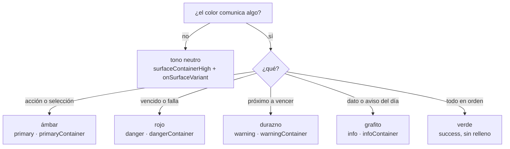
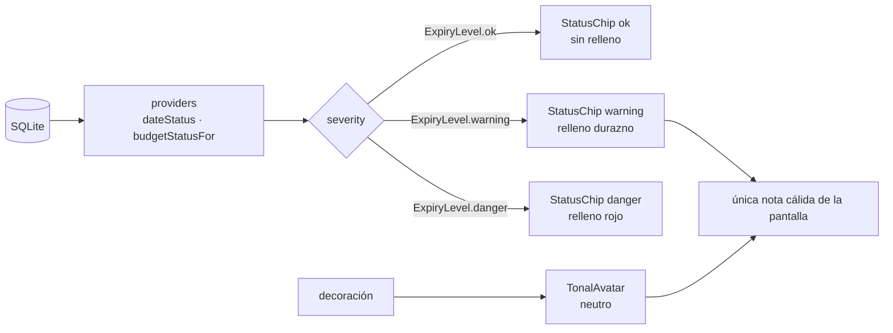

# Color de alertas — separar marca de severidad

> Implementado. Identidad **grafito + ámbar industrial** sin cambios; el ámbar
> deja de ser decoración y deja de significar severidad. Sin cambios en SQLite
> ni en la lógica de negocio.
>
> **Actualización posterior:** el pico y placa vive en la tira
> `RestrictionStrip` del Inicio (todos los vehículos configurados) y se
> mantiene como aviso informativo; `pico_y_placa_banner.dart` ya no existe.
> `AttentionSection` quedó solo con vencimientos.

## Problema

`warning` compartía el triple de tokens del ámbar de marca:

| Comparación | Antes | Resultado |
|---|---|---|
| `warningContainer` vs `primaryContainer` | `#FDE68A` vs `#FDE68A` | idénticos (1.0:1) |
| `warning` vs `primary` | `#B45309` vs `#B45309` | idénticos |
| `onWarningContainer` vs `accentText` | `#92400E` vs `#92400E` | idénticos |
| `warningContainer` (dark) vs `primaryContainer` | `#4A3208` vs `#3A2A08` | casi iguales |

Además el ámbar se usaba como decoración en 26 lugares (avatares de card,
tiles, encabezados de formulario, empty states, filas de ajustes) y `info`
también apuntaba a `primaryContainer`. En el dashboard podían coincidir 8–10
superficies ámbar: cuando todo es ámbar, nada es ámbar.

La banda cálida ya estaba saturada (danger 0°, warning 26°, marca 26°), así que
agregar otro naranja no resolvía nada. La solución es **escasez + peso visual**.

## Regla

## Tokens

| Token | Light | Dark |
|---|---|---|
| `warning` | `#C2410C` | `#FDBA74` |
| `warningContainer` | `#FFEDD5` | `#431407` |
| `onWarningContainer` | `#9A3412` | `#FED7AA` |
| `info` | `#475569` | `#CBD5E1` |
| `infoContainer` | `#E2E8F0` | `#334155` |
| `onInfoContainer` | `#1E293B` | `#E2E8F0` |

`success`, `danger`, `primary`, `primaryContainer` y `accentText` no cambian.

## Jerarquía por peso

| Estado | Tratamiento |
|---|---|
| `danger` | relleno rojo |
| `warning` | relleno durazno |
| `info` | sin relleno, grafito |
| `neutral` | superficie tonal |
| `ok` | sin relleno, verde |

## Flujo de una alerta en la UI

## Cambios

| Archivo | Qué cambió |
|---|---|
| `core/theme/app_colors.dart` | rampa `warning` a durazno + tokens `info` |
| `core/theme/app_semantic_colors.dart` | `info/onInfo/infoContainer/onInfoContainer` en `copyWith` y `lerp` |
| `shared/widgets/status_chip.dart` | jerarquía por peso: solo warning/danger con relleno |
| `shared/widgets/tonal_avatar.dart` | **nuevo**: icono decorativo en caja neutra (o `tone: warning`) |
| `shared/widgets/{stat_tile,form_section,empty_state}.dart` | avatar/ícono decorativo → `TonalAvatar` |
| `features/maintenance/{maintenance_list_screen,maintenance_form_screen,item_form_row}.dart` | avatar del vehículo y del ítem → neutro |
| `features/{fuel,expenses,documents}/widgets/*_card.dart` | avatar de card → neutro |
| `features/settings/screens/*.dart` | `_TonalIcon` de ajustes → `TonalAvatar` |
| `features/dashboard/widgets/recent_activity.dart` | chip “+n” → superficie tonal |
| `features/dashboard/widgets/favorite_vehicle_card.dart` | accesos rápidos → `onSurfaceVariant` |
| `features/dashboard/widgets/pico_y_placa_banner.dart` | card ámbar → `infoContainer` (aviso del día, no deterioro) |
| `test/core/theme/contrast_test.dart` | pares de `info`, contraste del avatar neutro y guardas “warning ≠ primary” |

## Verificación

- `flutter analyze` sin issues.
- `flutter test --concurrency 1`: 195 tests en verde.
- Contrastes AA: warning 5.18:1 sobre blanco, 6.38:1 en chip, 11.56:1 en dark;
  info 11.87:1 en claro y 6.97:1 en dark; avatar neutro 4.79:1 / 5.72:1.
- Pendiente: revisión visual en light/dark con text scale 1.3 y 2.0.

## Descartado

- **Ventana de aviso en dos niveles** (`8–30 d` suave / `≤7 d` fuerte): mejora
  real pero toca `ExpiryLevel`, `ReminderSeverity` y ~10 switches. Queda como
  fase 2.
- **Grafito como color de acción y ámbar exclusivo de alerta**: máxima
  legibilidad, pero recolorea FAB, CTAs, selección y date pickers.
