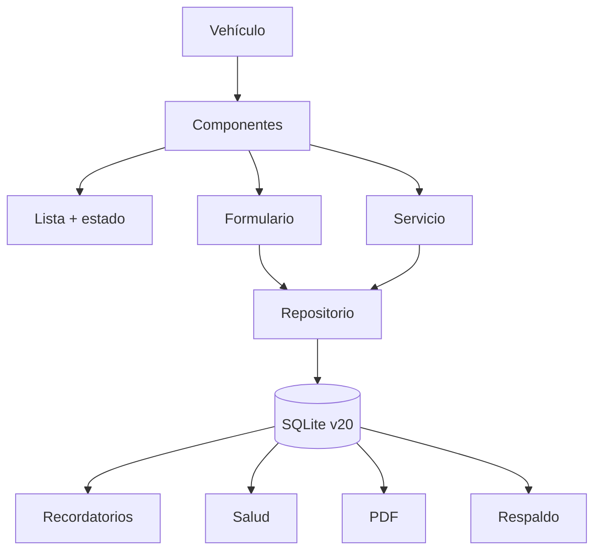

# Plan — Fase 3: Componentes y desgaste

> **Estado:** aprobado para planificación, pendiente de implementación.
> **Fecha:** 2026-11-13.
> **Copia canónica propuesta:** `docs/plans/plan-fase-3-componentes.md`
> (copiar y commitear al cambiar a un agente de implementación).
> **Copia de trabajo:** `/home/felipe/.opencode/plan/plan-fase-3-componentes.md`.
> **Decisión clave:** componentes genéricos para carro, moto, bici y camión.
> Sin UI especializada de camión (ejes, duales, rotación) en esta fase.

## 1. Contexto

MotorCheck ya tiene:

- Vehículos, mantenimientos, categorías, talleres.
- Combustible, gastos, finanzas y presupuesto.
- Documentos, pico y placa, recordatorios y notificaciones.
- Historial de kilometraje.
- Adjuntos en mantenimientos.
- Checklists e inspecciones.
- Respaldo ZIP/CSV y hoja de vida PDF.

La Fase 3 agrega el seguimiento de **componentes** que no encajan bien en una
categoría de mantenimiento: llantas, batería, cadena, frenos y suspensión.

## 2. Decisiones aprobadas

| Tema | Decisión |
|---|---|---|
| Tipos de vehículo | Carro, moto, bici y camión |
| Camión | Soporte genérico, sin UI especializada por ahora |
| Llantas | Un componente individual por llanta |
| Posición | Texto libre opcional (`Delantera`, `Eje 2 izquierda exterior`, etc.) |
| Repuesto | Componente individual opcional, control por meses/edad |
| Ejes/duales/rotación | Fase 3b opcional, no ahora |
| Tipos de componente | Llanta, batería, cadena, frenos, suspensión, otro |
| Servicios | Historial por componente; opción de reiniciar intervalo |
| Recordatorios | Integrados con la bandeja y notificaciones existentes |
| Salud | Penalización por componentes vencidos/próximos |
| PDF | Sección de componentes |
| Respaldo | Incluye las tablas nuevas |

## 3. Alcance

### Fase 3a — Componentes genéricos (esta entrega)

- CRUD de componentes.
- Historial de servicios por componente.
- Estado: al día, próximo, vencido.
- Cálculo por km, por meses o por ambos.
- Recordatorios y notificaciones.
- Salud del vehículo.
- PDF y respaldo.
- Componentes para todos los tipos de vehículo.
- Posición como texto libre.

### Fase 3b — Especialización de llantas (después, opcional)

- Campos de llanta: marca, medida, dibujo, presión.
- Ejes y posiciones estructuradas.
- Llantas duales.
- Rotación.
- Plantillas por configuración de camión.
- Cambio masivo de un juego.

### Fuera de alcance

- Catálogo OEM de componentes.
- Telemetría/OBD2.
- Sensores de presión.
- Gestión de flotas.
- Inventario de repuestos.
- Compra de repuestos.

## 4. Datos y migración

### Migración v20

```sql
CREATE TABLE components (
  id INTEGER PRIMARY KEY AUTOINCREMENT,
  vehicle_id INTEGER NOT NULL,
  name TEXT NOT NULL,
  type TEXT NOT NULL DEFAULT 'other',
  position TEXT,
  installed_at TEXT NOT NULL,
  installed_km INTEGER,
  interval_km INTEGER,
  interval_months INTEGER,
  warning_km INTEGER,
  warning_days INTEGER,
  notes TEXT,
  active INTEGER NOT NULL DEFAULT 1,
  created_at TEXT NOT NULL,
  updated_at TEXT NOT NULL,
  FOREIGN KEY (vehicle_id) REFERENCES vehicles(id) ON DELETE CASCADE
);

CREATE INDEX idx_components_vehicle
  ON components(vehicle_id, active);

CREATE TABLE component_services (
  id INTEGER PRIMARY KEY AUTOINCREMENT,
  component_id INTEGER NOT NULL,
  date TEXT NOT NULL,
  odometer INTEGER,
  cost REAL DEFAULT 0,
  notes TEXT,
  reset_interval INTEGER NOT NULL DEFAULT 0,
  created_at TEXT NOT NULL,
  FOREIGN KEY (component_id) REFERENCES components(id) ON DELETE CASCADE
);

CREATE INDEX idx_component_services_component
  ON component_services(component_id, date DESC);
```

### Modelos

| Modelo | Campos |
|---|---|
| `VehicleComponent` | id, vehicleId, name, type, position, installedAt, installedKm, intervalKm, intervalMonths, warningKm, warningDays, notes, active, createdAt, updatedAt |
| `ComponentService` | id, componentId, date, odometer, cost, notes, resetInterval, createdAt |
| `ComponentStatus` | component, remainingKm, remainingDays, isOverdue, isWarning, nextKm, nextDate |

### Tipos de componente

```dart
enum ComponentType { tire, battery, chain, brakes, suspension, other }
```

Etiquetas en español e iconos:

| Tipo | Etiqueta | Icono |
|---|---|---|
| tire | Llanta | `tire_repair` |
| battery | Batería | `battery_charging_full` |
| chain | Cadena | `link` |
| brakes | Frenos | `disc_full` |
| suspension | Suspensión | `settings` |
| other | Otro | `build` |

### Cálculo de estado

```text
nextKm   = installedKm + intervalKm
nextDate = installedAt + intervalMonths

remainingKm   = nextKm - currentMileage
remainingDays = nextDate - today
```

- **Vencido** si `remainingKm < 0` o `remainingDays < 0`.
- **Próximo** si está dentro de `warningKm` o `warningDays`.
- **Al día** en otro caso.
- Se muestra **lo que ocurra primero**.
- Sin `intervalKm`/`intervalMonths`, el componente es solo informativo.

### Servicios y reinicio de intervalo

Al registrar un servicio:

- Se guarda fecha, odómetro, costo, notas.
- `resetInterval` es opcional.
- Si `resetInterval = true`, se actualizan `installed_at` e `installed_km`
  del componente con la fecha/odómetro del servicio.
- Sirve para:
  - cambio de llanta,
  - cambio de batería,
  - cambio de pastillas,
  - servicio que reinicia el ciclo.
- Si es una rotación o revisión, se deja `resetInterval = false`.

## 5. Datos demo sugeridos

Opcional, para probar la UI:

### Mazda 33

```text
Llanta delantera izquierda
Llanta delantera derecha
Llanta trasera izquierda
Llanta trasera derecha
Llanta de repuesto
Batería
```

### Yamaha FZ

```text
Llanta delantera
Llanta trasera
Cadena
Batería
```

### Bicicleta Trek eléctrica

```text
Llanta delantera
Llanta trasera
Cadena
Batería
```

### Camión (si se quiere mostrar el caso genérico)

```text
Llanta eje 1 izquierda
Llanta eje 1 derecha
Llanta eje 2 izquierda exterior
Llanta eje 2 izquierda interior
Llanta eje 2 derecha interior
Llanta eje 2 derecha exterior
Batería
```

No se crean automáticamente para todos; se pueden insertar unos pocos como demo.

## 6. Interfaz

### Detalle del vehículo

Agregar tarjeta:

```text
+--------------------------------------------+
| Componentes                    Ver todo >  |
+--------------------------------------------+
| Llanta delantera   En 300 km   [warning]   |
| Batería            En 4 meses  [ok]        |
| Frenos             Vencido     [danger]    |
+--------------------------------------------+
```

Ruta:

```text
/vehicles/:id/components
```

### Lista de componentes

```text
+--------------------------------------------+
| Componentes · Mazda 33                     |
| [Todos] [Llantas] [Batería] [Otros]        |
+--------------------------------------------+
| Llantas                                     |
|  Delantera izq.   En 300 km    [warning]   |
|  Delantera der.   En 300 km    [warning]   |
|  Trasera izq.     En 2.400 km  [ok]        |
|  Trasera der.     En 2.400 km  [ok]        |
|  Repuesto         En 8 meses   [ok]        |
+--------------------------------------------+
| Batería                                     |
|  Batería principal  En 4 meses  [ok]       |
+--------------------------------------------+
| [ + Agregar componente ]                    |
+--------------------------------------------+
```

- Agrupada por tipo.
- Filtros por tipo.
- Estado con icono + texto + color.
- “Ver historial” en cada componente.

### Formulario de componente

```text
+--------------------------------------------+
| Nuevo componente                           |
+--------------------------------------------+
| Tipo        [Llanta v]                     |
| Nombre      [Llanta delantera izquierda]   |
| Posición    [Delantera izquierda]          |
+--------------------------------------------+
| Instalación                                |
| Fecha       [10/11/2026]                   |
| Kilometraje [152300]                       |
+--------------------------------------------+
| Frecuencia                                 |
| Cada        [50000] km                     |
| Aviso       [3000] km antes                |
| Cada        [60] meses                     |
| Aviso       [30] días antes                |
+--------------------------------------------+
| [ ] Activo                                 |
| Notas       [____________________]         |
+--------------------------------------------+
| [ Guardar componente ]                      |
+--------------------------------------------+
```

### Historial / servicio

```text
+--------------------------------------------+
| Llanta delantera izquierda                 |
+--------------------------------------------+
| Instalada: 10 nov 2026 · 152.300 km        |
| Estado: En 300 km · Vence en 12 días       |
+--------------------------------------------+
| Servicios                                  |
| 10 nov · 152.300 km · $ 250.000 · Cambio   |
| 20 may · 145.000 km · $ 0 · Rotación       |
+--------------------------------------------+
| [ Registrar servicio ]                     |
+--------------------------------------------+
```

Formulario de servicio:

```text
+--------------------------------------------+
| Registrar servicio                         |
+--------------------------------------------+
| Fecha       [10/11/2026]                   |
| Odómetro    [152300]                       |
| Costo       [$ 250000]                     |
| Notas       [Cambio de llanta]             |
| [x] Este servicio reinicia el intervalo    |
+--------------------------------------------+
| [ Guardar servicio ]                       |
+--------------------------------------------+
```

## 7. Flujo



## 8. Archivos

### Base de datos

| Archivo | Cambio |
|---|---|
| `lib/core/database/tables.dart` | DDL `components`, `component_services` |
| `lib/core/database/database_helper.dart` | versión 20 + migración v20 |
| `lib/core/backup/backup_service.dart` | tablas nuevas + schema 20 + CSV |

### Modelos y datos

| Archivo | Cambio |
|---|---|
| `lib/features/components/models/vehicle_component.dart` | Nuevo freezed |
| `lib/features/components/models/component_service.dart` | Nuevo freezed |
| `lib/features/components/models/component_status.dart` | Estado calculado |
| `lib/features/components/repository.dart` | CRUD + servicios + estado |
| `lib/features/components/providers.dart` | Providers + notifier |

### UI

| Archivo | Cambio |
|---|---|
| `lib/features/components/screens/components_screen.dart` | Lista y filtros |
| `lib/features/components/screens/component_form_screen.dart` | Alta/edición |
| `lib/features/components/screens/component_detail_screen.dart` | Detalle + historial |
| `lib/features/components/screens/component_service_form_screen.dart` | Servicio |
| `lib/features/components/widgets/component_card.dart` | Card de componente |
| `lib/features/components/widgets/component_status_chip.dart` | Estado visual |
| `lib/features/vehicles/screens/vehicle_detail_screen.dart` | Tarjeta “Componentes” |
| `lib/routes/app_router.dart` | Rutas nuevas |

### Integraciones

| Archivo | Cambio |
|---|---|
| `lib/features/reminders/models/reminder.dart` | `ReminderKind.component` |
| `lib/features/reminders/providers.dart` | Incluir componentes |
| `lib/features/reminders/health_score.dart` | Penalización |
| `lib/features/reports/report_data.dart` | Componentes |
| `lib/features/reports/pdf_report_service.dart` | Sección de componentes |
| `lib/features/dashboard/widgets/finance_summary_card.dart` | No cambia |
| `lib/features/dashboard/screens/dashboard_screen.dart` | Opcional: card de componentes críticos |

### Docs

| Archivo | Cambio |
|---|---|
| `docs/database.md` | v20 + tablas + relaciones |
| `docs/architecture.md` | Feature components + flujo |
| `docs/testing.md` | Pruebas nuevas |
| `AGENTS.md` | Árbol, modelos, versión 20 |
| `README.md` | Funcionalidad |
| `docs/plans/plan-fase-3-componentes.md` | Copia canónica del plan |

## 9. Recordatorios y salud

### Recordatorios

- Nuevo `ReminderKind.component`.
- Título: nombre del componente.
- Subtítulo: tipo + posición.
- Severidad:
  - vencido → danger
  - próximo → warning
- Ruta: `/vehicles/:id/components`.
- Notificación con la misma infraestructura.
- Se recalcula al abrir la app y al cambiar km/componentes.

### Salud

Propuesta de penalización:

```text
-8 por componente vencido   (máx. 24)
-3 por componente próximo   (máx. 12)
```

Mantener los pesos actuales de mantenimiento y documentos. Actualizar la fórmula
y las pruebas.

## 10. PDF

Agregar sección “Componentes” con:

- Nombre
- Posición
- Instalado (fecha/km)
- Próximo (km/fecha)
- Estado

Tomar máximo 12 componentes para no alargar el PDF.

## 11. Respaldo

- Agregar `components` y `component_services` a `_tables`.
- Subir `_backupSchemaVersion` a 20.
- CSV incluye ambas tablas.
- Restaurar mantiene compatibilidad con copias v19.
- No hay adjuntos nuevos.

## 12. Pruebas

### Unitarias

- CRUD de componentes.
- Estado por km.
- Estado por fecha.
- Estado por ambos (“lo que ocurra primero”).
- Componente sin intervalo → informativo.
- Servicio con `resetInterval = true` actualiza instalación.
- Servicio con `resetInterval = false` no la actualiza.
- Recordatorios incluyen componentes vencidos/próximos.
- Salud descuenta componentes.
- Backup round-trip de las tablas nuevas.

### Widget

- Lista de componentes a 360 px y text scale 2.0.
- Formulario de componente.
- Historial/servicio.
- Card en detalle del vehículo.
- Filtros por tipo.

### Manual

- Crear llanta delantera y trasera.
- Crear 4 llantas de carro.
- Crear repuesto.
- Crear 6 llantas de camión manualmente.
- Registrar cambio con reinicio de intervalo.
- Ver recordatorio y PDF.
- Restaurar respaldo.

## 13. Orden de implementación

1. Migración v20 + modelos + repositorio.
2. Providers y cálculo de estado.
3. Pantalla de lista.
4. Formulario de componente.
5. Detalle + historial + servicio.
6. Tarjeta en detalle del vehículo.
7. Recordatorios + salud.
8. PDF + respaldo + CSV.
9. Pruebas.
10. Docs.
11. Datos demo.
12. Hot restart, builds.

## 14. Checklist de estado

### Base y datos

- [x] Tablas v20.
- [x] Migración v20.
- [x] Modelos freezed.
- [x] Repositorio.
- [x] Providers.
- [x] Cálculo de estado.

### UI

- [x] Lista de componentes.
- [x] Filtros por tipo.
- [x] Formulario de componente.
- [x] Detalle.
- [x] Historial de servicios.
- [x] Formulario de servicio.
- [x] Tarjeta en vehículo.
- [x] Rutas.

### Integraciones

- [x] Recordatorios.
- [x] Notificaciones.
- [x] Salud.
- [x] PDF.
- [x] Respaldo/CSV.

### Cierre

- [x] Pruebas.
- [x] Docs.
- [x] Datos demo.
- [x] Hot restart.
- [x] Build Linux.
- [x] Build APK.

## 15. Riesgos y decisiones abiertas

| Riesgo / decisión | Propuesta |
|---|---|
| Muchos componentes en camión | Posición libre + agrupación por tipo; sin presets aún |
| Llantas duales | Fase 3b |
| Rotación | Fase 3b |
| Servicio reinicia intervalo | Checkbox, por defecto apagado |
| Repuesto | Componente individual, normalmente solo por meses |
| Componentes inactivos | Campo `active`; no generan recordatorios |
| Salud | Pesos -8/-3 con topes |
| PDF extenso | Máximo 12 componentes |
| Camión | Soportado genéricamente, sin UI especial |

## 16. Cómo retomar

1. Leer este archivo.
2. Revisar el estado del repo:
   ```bash
   git status
   git log --oneline -5
   ```
3. Confirmar que la base está en v19 antes de migrar a v20.
4. Implementar en el orden de la sección 13.
5. Marcar la checklist.
6. Ejecutar:
   ```bash
   flutter pub get
   dart run build_runner build --delete-conflicting-outputs
   dart format .
   flutter analyze
   flutter test --concurrency 1
   flutter build linux --release --no-tree-shake-icons
   flutter build apk --release
   ```

## 17. Copia canónica

Al cambiar a un agente de implementación:

```bash
mkdir -p docs/plans
cp /home/felipe/.opencode/plan/plan-fase-3-componentes.md \
   docs/plans/plan-fase-3-componentes.md
```

Commit sugerido:

```bash
git add docs/plans/plan-fase-3-componentes.md
git commit -m "docs: agregar plan de fase 3 de componentes"
```
