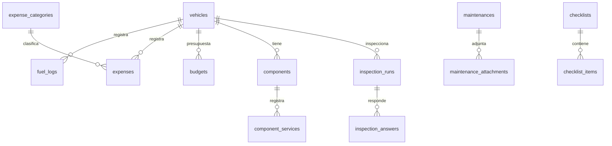
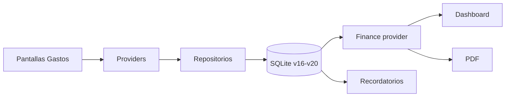

# Plan — Finanzas y mantenimiento avanzado

> **Estado:** Fases 1–2 implementadas; extras menores y Fase 3 pendientes.
> **Fecha:** 2026-11-13.
> **Ubicación canónica:** `docs/plans/plan-finanzas-y-mantenimiento-avanzado.md`.
> **Copia de trabajo:** `/home/felipe/.opencode/plan/plan-finanzas-y-mantenimiento-avanzado.md`.
> **Siguiente paso:** commitear y comenzar la Fase 3 (componentes).

## 1. Contexto

MotorCheck ya tiene implementado:

- Vehículos, mantenimientos, categorías, talleres.
- Próximos por km y por fecha.
- Kilometraje con historial y fecha estimada.
- Documentos con adjuntos, vigencia e historial.
- Pico y placa semanal.
- Recordatorios y notificaciones locales.
- Respaldo ZIP + CSV y restauración.
- Hoja de vida en PDF.
- Salud del vehículo.

Este plan cubre el **backlog recomendado**: dinero real, mantenimiento avanzado y
componentes. No cubre integraciones que rompen la promesa local-first.

## 2. Decisiones aprobadas

| Tema | Decisión |
|---|---|
| Navegación | Quinta pestaña **Gastos** |
| Combustible | Modelo listo para gasolina, diésel, GNV y eléctrico |
| Gastos | Por vehículo, con opción de gasto global sin vehículo |
| Presupuesto | En fase posterior, cuando ya existan datos |
| Adjuntos | Sí, en mantenimientos, reutilizando almacenamiento y respaldo |
| Importación CSV | Condicionada a que existan datos históricos que migrar |
| Plantillas por modelo | Condicionadas a una fuente confiable; preferir plantillas manuales |
| Nube/SIMIT/RUNT/OCR/IA/OBD2/GPS/flotas | Fuera de alcance |

## 3. Alcance por fases

### Fase 1 — Dinero real

- Combustible.
- Gastos generales.
- Pestaña Gastos con Resumen, Combustible y Gastos.
- Reportes y costo por km real.
- Resumen financiero en Inicio.
- PDF con costo total de propiedad.

### Fase 2 — Mantenimiento avanzado

- Adjuntos en mantenimientos.
- Pantalla de historial de kilometraje.
- Checklists e inspecciones.
- Presupuesto mensual.

### Fase 3

> La implementación final de esta fase se detalla en
> `docs/plans/plan-fase-3-componentes.md`. En la v21 el reemplazo de
> componentes vive dentro del mantenimiento (`maintenance_items.component_id`)
> y ya no existe `component_services`. — Componentes

- Llantas, batería, cadena, frenos, suspensión y otros.
- Historial de servicios por componente.
- Recordatorios y salud del vehículo.
- Plantillas manuales solo si se confirma la necesidad.

## 4. Fuera de alcance

- Sincronización en la nube.
- SIMIT/RUNT/SOAT automático.
- Pico y placa con dataset oficial.
- OCR/IA de facturas.
- OBD2.
- GPS/bitácora de viajes.
- Flotas/multiusuario.
- Importación CSV hasta confirmar datos históricos.
- Catálogo OEM de plantillas por marca/modelo.

## 5. Datos y migraciones

### Diagrama Entidad-Relación



### Migraciones

| Versión | Contenido |
|---|---|
| **v16** | `fuel_logs`, `expense_categories`, `expenses` |
| **v17** | `maintenance_attachments` |
| **v18** | `checklists`, `checklist_items`, `inspection_runs`, `inspection_answers` |
| **v19** | `budgets` |
| **v20** | `components`, `component_services` |

Reglas:

- Migraciones aditivas.
- Probar con una base v15 real.
- No ejecutar backfills en cada apertura.
- Actualizar `DatabaseHelper` y `Tables`.

### Tablas propuestas

```sql
fuel_logs (
  id, vehicle_id, date, odometer, quantity, unit_price, total_cost,
  fuel_type, station, full_tank, notes, created_at, updated_at
)

expense_categories (
  id, key, name, icon_name, sort_order, created_at
)

expenses (
  id, vehicle_id, category_key, date, amount, notes, receipt_path,
  created_at, updated_at
)

budgets (
  id, vehicle_id, period, amount, created_at, updated_at
)

maintenance_attachments (
  id, maintenance_id, item_id, name, file_path, created_at
)

checklists (
  id, vehicle_id, vehicle_type, name, created_at
)

checklist_items (
  id, checklist_id, label, sort_order
)

inspection_runs (
  id, vehicle_id, checklist_id, date, odometer, notes, created_at
)

inspection_answers (
  id, run_id, item_id, status, notes
)

components (
  id, vehicle_id, name, type, position, installed_at, installed_km,
  interval_km, interval_months, warning_km, warning_days, notes,
  active, created_at, updated_at
)

component_services (
  id, component_id, date, odometer, cost, notes, created_at
)
```

## 6. Respaldo

Actualizar `BackupService`:

- Agregar todas las tablas nuevas a `_tables`.
- Subir `_backupSchemaVersion`.
- Exportar CSV de combustible, gastos, presupuestos, checklists y componentes.
- Incluir en el ZIP los adjuntos de mantenimiento, no solo documentos.
- Restaurar copias antiguas sin romper.
- Probar round-trip con adjuntos y tablas nuevas.

## 7. Navegación y UI

### Navegación

```text
[ Inicio ] [ Mantenimientos ] [ Vehículos ] [ Gastos ] [ Ajustes ]
```

Dentro de Gastos:

```text
[ Resumen ] [ Combustible ] [ Gastos ]
```

Riesgo: 5 etiquetas en 360 px. Probar text scale 2.0.

### Flujo de datos



### Bosquejo — Resumen

```text
+--------------------------------------------+
| Gasto noviembre        $ 620.000           |
| Mantenimiento $ 180.000                    |
| Combustible   $ 350.000                    |
| Otros gastos  $  90.000                    |
| Costo por km          $ 520                 |
+--------------------------------------------+
| [gráfica de gasto mensual]                 |
+--------------------------------------------+
```

### Bosquejo — Combustible

```text
+--------------------------------------------+
| Combustible · Mazda 33                     |
+--------------------------------------------+
| Consumo promedio      12,4 km/L            |
| Gasto noviembre       $ 350.000            |
| Costo por km          $ 420                 |
+--------------------------------------------+
| 10 nov · 89.000 km · 42 L · $ 180.000      |
| 28 oct · 84.500 km · 38 L · $ 162.000      |
+--------------------------------------------+
| [ + Registrar tanqueada ]                  |
+--------------------------------------------+
```

### Bosquejo — Gastos

```text
+--------------------------------------------+
| Gastos · Noviembre                         |
+--------------------------------------------+
| Total mes                         $ 620.000 |
| Seguro $ 380.000 · Peajes $ 90.000          |
+--------------------------------------------+
| [Seguro] [Impuesto] [Peajes] [Otros]       |
| 12 nov · Peaje       $ 18.000              |
| 05 nov · Seguro      $ 380.000             |
+--------------------------------------------+
```

### Bosquejo — Componentes

```text
+--------------------------------------------+
| Componentes · Yamaha FZ                    |
+--------------------------------------------+
| Cadena      En 300 km        [warning]     |
| Llanta tras. Vencida 200 km  [danger]      |
| Batería     En 4 meses       [ok]          |
+--------------------------------------------+
| [ + Agregar componente ]                   |
+--------------------------------------------+
```

## 8. Archivos por fase

### Fase 1

| Archivo | Cambio |
|---|---|
| `lib/features/fuel/models/fuel_log.dart` | Nuevo modelo freezed |
| `lib/features/fuel/repository.dart` | CRUD y cálculos |
| `lib/features/fuel/providers.dart` | Estado y estadísticas |
| `lib/features/fuel/screens/fuel_list_screen.dart` | Lista y resumen |
| `lib/features/fuel/screens/fuel_form_screen.dart` | Alta/edición |
| `lib/features/fuel/widgets/fuel_card.dart` | Fila de tanqueada |
| `lib/features/expenses/models/expense.dart` | Nuevo modelo |
| `lib/features/expenses/models/expense_category.dart` | Nuevo modelo |
| `lib/features/expenses/repository.dart` | CRUD |
| `lib/features/expenses/providers.dart` | Estado y totales |
| `lib/features/expenses/screens/expenses_screen.dart` | Lista |
| `lib/features/expenses/screens/expense_form_screen.dart` | Alta/edición |
| `lib/features/expenses/screens/expense_categories_screen.dart` | Categorías |
| `lib/features/finance/providers.dart` | Totales combinados |
| `lib/features/finance/screens/finance_screen.dart` | Pestaña Gastos |
| `lib/features/dashboard/widgets/finance_summary_card.dart` | Resumen en Inicio |
| `lib/features/reports/report_data.dart` | Incluir finanzas |
| `lib/features/reports/pdf_report_service.dart` | PDF con costo real |
| `lib/routes/app_router.dart` | 5ª pestaña y rutas |
| `lib/routes/app_router.dart` (`AppShell`) | Nuevo destino |
| `pubspec.yaml` | Sin dependencia nueva: gráfica mensual propia |
| `lib/core/database/tables.dart` | DDL v16 |
| `lib/core/database/database_helper.dart` | Migración v16 |
| `lib/core/backup/backup_service.dart` | Tablas y CSV nuevos |

### Fase 2

| Archivo | Cambio |
|---|---|
| `lib/core/files/file_storage.dart` | Mover desde documents |
| `lib/features/maintenance/models/maintenance_attachment.dart` | Nuevo |
| `lib/features/maintenance/repository.dart` | Adjuntos |
| `lib/features/maintenance/screens/maintenance_detail_screen.dart` | Adjuntos |
| `lib/features/vehicles/screens/mileage_history_screen.dart` | Nuevo |
| `lib/features/vehicles/widgets/mileage_chart.dart` | Nuevo |
| `lib/features/checklists/...` | Feature nuevo |
| `lib/features/finance/screens/finance_summary_view.dart` | Tarjeta de presupuesto |
| `lib/core/database/tables.dart` | DDL v17–v19 |
| `lib/core/database/database_helper.dart` | Migraciones |
| `lib/core/backup/backup_service.dart` | Adjuntos y tablas |

### Fase 3

| Archivo | Cambio |
|---|---|
| `lib/features/components/models/vehicle_component.dart` | Nuevo |
| `lib/features/components/models/component_service.dart` | Nuevo |
| `lib/features/components/repository.dart` | CRUD |
| `lib/features/components/providers.dart` | Estado |
| `lib/features/components/screens/components_screen.dart` | Lista |
| `lib/features/components/screens/component_form_screen.dart` | Alta/edición |
| `lib/features/components/screens/component_service_form_screen.dart` | Servicio |
| `lib/features/reminders/models/reminder.dart` | `ReminderKind.component` |
| `lib/features/reminders/providers.dart` | Cálculo |
| `lib/features/reminders/health_score.dart` | Penalización |
| `lib/features/reports/report_data.dart` | Componentes |
| `lib/core/database/tables.dart` | DDL v20 |
| `lib/core/database/database_helper.dart` | Migración |

## 9. Pruebas

### Unitarias

- Consumo con tanque lleno y parcial.
- Costo por km con mantenimiento + combustible + gastos.
- Totales por categoría y mes.
- Presupuesto al 80 % y 100 %.
- Componente vencido por km, fecha y ambos.
- Checklist: respuestas y estado final.
- Backup round-trip con tablas y adjuntos nuevos.
- Migraciones v16 → v20.
- PDF con finanzas y muchos registros.

### Widget

- Pestaña Gastos a 360, 412 y 420 px.
- Formularios de combustible y gasto.
- Estados vacíos y errores.
- Dashboard con y sin datos.
- Checklist y componentes.
- Text scale 2.0 sin overflow.

### Manual

- Crear tanqueada y ver consumo/costo por km.
- Crear gasto global y por vehículo.
- Adjuntar factura a mantenimiento y restaurar respaldo.
- Ver PDF con costo real.
- Ver recordatorio de componente.
- Probar 5 pestañas en Android y Linux.

## 10. Orden de implementación

1. **Entrega 1:** combustible + gastos + pestaña Gastos + reportes básicos.
2. **Entrega 2:** adjuntos + historial de km + checklists + presupuesto.
3. **Entrega 3:** componentes y, si aplica, plantillas manuales.

Cada entrega debe incluir:

- Migración.
- Modelos/repos/providers.
- Pantallas.
- Pruebas.
- Actualización de `docs/database.md`, `docs/architecture.md`, `docs/testing.md`, `AGENTS.md` y `README.md`.
- `flutter analyze` y `flutter test --concurrency 1`.

## 11. Checklist de estado

### Fase 1

- [x] Modelo y migración v16.
- [x] Repositorio y providers de combustible.
- [x] Pantallas de combustible.
- [x] Repositorio y providers de gastos.
- [x] Pantallas de gastos y categorías.
- [x] Pestaña Gastos con Resumen.
- [x] Resumen financiero en Inicio.
- [x] Costo por km real.
- [x] PDF con finanzas.
- [x] Respaldo/CSV actualizado.
- [x] Pruebas.
- [x] Docs.

### Fase 2

- [x] Mover almacenamiento de archivos a core.
- [x] Adjuntos en mantenimientos.
- [x] Historial de kilometraje.
- [x] Checklist pre-viaje y ejecución de inspecciones.
- [ ] Editor de checklists personalizadas.
- [x] Presupuesto por vehículo.
- [ ] Presupuesto global.
- [x] Migraciones.
- [x] Respaldo.
- [x] Pruebas.
- [x] Docs.

#### Ajustes posteriores de Fase 2

- [x] Fecha de lectura de mantenimiento = fecha del mantenimiento.
- [x] Crear/editar vehículo agrega lectura de kilometraje.
- [x] Colores de presupuesto: verde/ámbar/rojo.
- [x] Chip de presupuesto en Inicio al 80 %/100 %.
- [x] Previsualización de adjuntos de imagen y PDF.
- [x] Notificación local al cruzar 80 %/100 %, con deduplicación mensual.

### Fase 3

- [ ] Modelo de componentes.
- [ ] Pantallas.
- [ ] Recordatorios.
- [ ] Salud del vehículo.
- [ ] PDF.
- [ ] Migración.
- [ ] Pruebas.
- [ ] Docs.

## 12. Cómo retomar

1. Leer este archivo.
2. Revisar `git status` y `git log`.
3. Confirmar que la base está en v19.
4. Implementar la Fase 1 en el orden indicado.
5. Actualizar la checklist al terminar cada punto.
6. Ejecutar:
   ```bash
   flutter pub get
   dart run build_runner build --delete-conflicting-outputs
   dart format .
   flutter analyze
   flutter test --concurrency 1
   flutter build linux --release --no-tree-shake-icons
   flutter build apk --release
   ```

## 13. Decisiones abiertas

- ¿Existen datos históricos en CSV/Excel para justificar importación?
- ¿Las plantillas serán manuales o habrá un catálogo por marca/modelo?
- ¿Combustible mostrará GNV/eléctrico desde el inicio o solo el modelo?
- ¿Presupuesto por vehículo, global o ambos?
- ¿Los adjuntos de mantenimiento se asociarán a items o solo al mantenimiento?
- ¿Quinta pestaña o sección dentro del vehículo si 360 px queda apretado?

## 14. Datos demo

Se conservan los datos demo insertados en la base real. Respaldos previos:

- `/tmp/opencode/motorcheck-before-seed.db`
- `/tmp/opencode/motorcheck-pre-v15.db`

No borrar sin decisión explícita.
