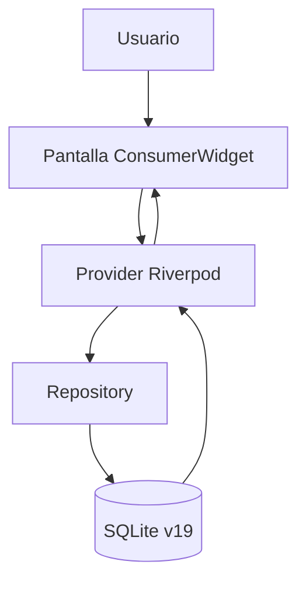
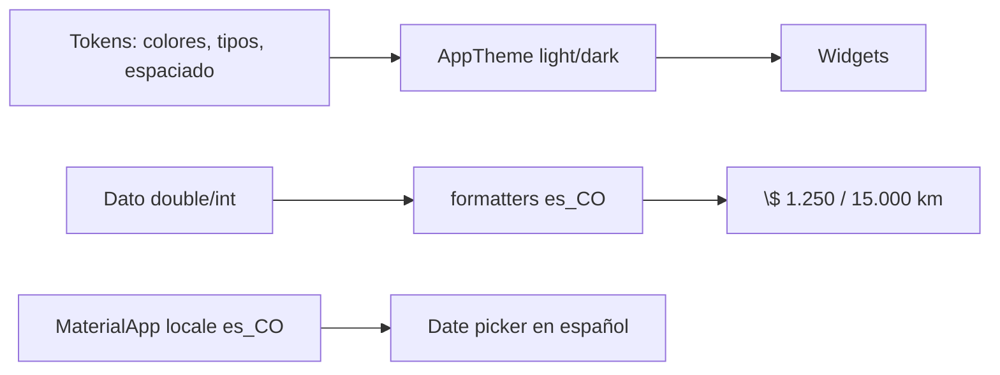

# Rediseño Mobile 2.0 — MotorCheck

> Plan aprobado. Identidad **grafito + ámbar industrial**, Material 3 y Barlow.
> Sin cambios en SQLite ni en la lógica de negocio.

## Estado de implementación

- [x] Fase 0: tokens, Barlow, `es_CO`, localización, formatos.
- [x] Fase 1: shell con etiquetas visibles, badge, edge-to-edge, snackbar global.
- [x] Fase 2: `VehicleAvatar`, `StatusChip`, `FormSection`, `StickyBottomBar`, etc.
- [x] Fase 3: dashboard, vehículos y mantenimientos rediseñados.
- [x] Fase 4: formularios con secciones, barra fija, guardia de cambios.
- [x] Fase 5: ajustes, accesibilidad, motion y contraste.
- [x] Fase 6: icono, launcher, tests de contraste, docs y builds.
- [ ] Verificación manual en dispositivo Android físico (pendiente del usuario).

## Objetivo

Convertir MotorCheck en una app Android con identidad de taller, navegación
clara, formularios eficientes y accesibilidad AA, manteniendo intacta la capa
de datos.

## Identidad

| Rol | Light | Dark |
|---|---|---|
| background | `#F5F4F1` | `#121417` |
| surface | `#FFFFFF` | `#1A1D21` |
| surfaceContainer | `#EAE7E0` | `#22262B` |
| onSurface | `#1B1D21` | `#E8E6E1` |
| onSurfaceVariant | `#5A5F66` | `#A6A9AE` |
| outline | `#7F848B` | `#6B7077` |
| primary / señal | `#B45309` | `#FBBF24` |
| onPrimary | `#FFFFFF` | `#1F2328` |
| primaryContainer | `#FDE68A` | `#3A2A08` |
| success | `#047857` | `#34D399` |
| warning | `#B45309` | `#FBBF24` |
| danger | `#B91C1C` | `#F87171` |

El ámbar significa acción o atención. En estados siempre va acompañado de
icono y texto. El azul queda reservado para el tipo de vehículo “carro”.

## Tipografía

- **Barlow Semi Condensed 600/700**: títulos y cifras.
- **Barlow 400/500/600**: cuerpo, labels y navegación.
- Fuentes empaquetadas en `assets/fonts/` con licencia OFL.

## Flujo de datos



## Flujo de presentación



## Interfaz — Inicio antes

```text
+------------------------------------------+
|              MotorCheck                  |
+------------------------------------------+
| [car] Mi carro             [*]   >       |
| Toyota Corolla . ABC123                  |
| 150.000 km                               |
| ---------------------------------------- |
|  Mantenim.   Detalles   Proximos         |
+------------------------------------------+
| [garaje] 2 vehiculos                     |
| [12] Mantenimientos  [$1,250] Julio      |
+------------------------------------------+
| [!] Documentos por vencer                |
| SOAT . Mi carro        Vence en 12d      |
+------------------------------------------+
 [inicio] [mant.] [vehic.] [config]  sin etiquetas
```

## Interfaz — Inicio después

```text
+------------------------------------------+
| Buenas tardes              [Mi carro v]  |
| Tu carro esta al dia                     |
+------------------------------------------+
| [car] Toyota Corolla                     |
| ABC123 . 150.000 km           [*]        |
| SOAT  [########--]  12 dias              |
| [ Registrar mantenimiento ] [Prox.]      |
+------------------------------------------+
| Proximos por kilometraje                 |
| [Aceite: faltan 1.200 km] [Frenos: 300]  |
+------------------------------------------+
| Documentos                               |
| SOAT 12 dias [########--]                |
| RTM 118 dias [############]              |
+------------------------------------------+
| Gasto julio $ 1.250   Mantenim. 12       |
| Actividad reciente >                     |
+------------------------------------------+
 [ Inicio ] [ Mant. ] [ Vehiculos ] [Ajustes]
```

## Fases

1. **Fase 0–1**: tokens, tema, localización, formatos, shell y navegación.
2. **Fase 2–3**: componentes compartidos y pantallas principales.
3. **Fase 4–5**: detalles, formularios, accesibilidad y motion.
4. **Fase 6**: QA, documentación, icono y APK.

## Verificación

```bash
flutter analyze
flutter test --concurrency 1
flutter test test/core/theme/contrast_test.dart
flutter build apk --release
```

Manual: 360×800 y 412×915, light/dark, text scale 1.0/1.3/2.0, date picker
en español, guardado con snackbar, formulario con teclado abierto y ventana
Linux 420×880.
